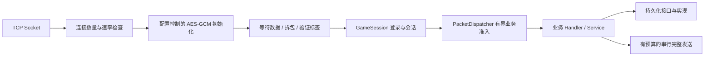

# TCP 架构与资源管理

依赖方向：Protocol 无业务依赖；Networking 依赖 Protocol；Gameplay 依赖 Networking/Protocol 定义的接口；Data 是独立数据库基础库；Infrastructure 依赖 Data，实现业务的认证、持久化接口和具体表仓储；Host 组装各层。命名空间统一为 `GameServer.<模块>`，异步方法使用 `Async` 后缀。Manager 管理集合和生命周期，Service 提供请求驱动的业务规则，Handler 处理协议消息，Module 集中注册本模块组件。System 保留给将来确实需要的 ECS/帧更新系统。单例通过 DI 注册和管理，不增加全局静态单例入口。

没有 HTTP/WebSocket/TLS 监听器。默认 `Encryption.Mode=AesGcm`，每个连接首次发送 40 字节初始化信息，再逐包加解密；需要有效通信密钥。显式设置 `Encryption.Mode=None` 可关闭加密，此时没有额外初始化包，客户端直接发送 GWS1 二进制帧。更改配置后重启，客户端使用相同模式。

当前模块、推送、管理服务及用法见 [模块设计](modules.md)；采纳前的评估保留在 [架构评估及 GameServer2026 借鉴建议](reviews/tcp-architecture.md)。

数据库驱动与具体数据表的两层封装见 [数据库开发指南](database.md)。驱动包不进入 Gameplay 或 Protocol 的依赖；MySQL 与 SQLite 复用业务仓储及其接口，参数化 CRUD、连接释放、命令串行、事务与错误分类由 Data 层管理。

## 连接与内存生命周期

`TcpServer` 管理 socket 的创建、连接数量槽位、停止接受新连接以及退出时排空。每个连接有独立 `GameSession`；断开、超时、异常均通过 `finally` 归还缓冲区、移除会话、释放连接槽位和加密对象。

默认先用零字节读取等待 socket 可读，不为每个空闲连接提前保留 4 KiB 接收数组。实际收到数据后从 `ManagedBufferPool` 租借起始 1 KiB 缓冲区，按帧长度扩容，处理结束归还。读取开始后限制组包时间；登录和空闲超时由会话层管理。零字节读取仍有 socket、异步任务、会话等固定成本，不等于连接零内存。

`IConnectionMessageSender` / `ConnectionMessageSender` 集中负责应答及通知的帧编码、长度检查和缓冲区所有权，`GameSession` 不再直接租借缓冲区，业务连接处理器也不再依赖 TCP 配置。发送在连接内串行，异步发送完成前持有消息数据所有权。加密只在获得发送锁后租借输出数组，避免为排队等待的每次发送分配完整密文数组。AES 解密直接在接收缓冲区内进行，通过标签校验后才交给 Protobuf。接收与发送池均有总使用预算及空闲保留上限；当前保持安全托管实现。

## 默认上限

| 配置 | 默认值 | 超出后的行为 |
| --- | --- | --- |
| `Networking.MaxConnections` | 8000 | 接受后立即关闭多余 socket，不进入登录流程 |
| `Networking.MaxNewConnectionsPerSecond` / `ConnectionBurst` | 1000/s / 2000 | 超过令牌桶额度立即关闭 |
| `Networking.Backlog` | 512 | 内核监听队列容量，与在线连接上限不同 |
| `Gameplay.MaxUnauthenticatedConnections` | 1024 | 拒绝额外未登录会话 |
| `Gameplay.LoginTimeoutSeconds` | 10 秒 | 未完成登录则关闭 |
| `Gameplay.IdleTimeoutSeconds` | 120 秒 | 无有效协议活动则关闭 |
| `Networking.PacketTimeoutSeconds` | 10 秒 | 数据开始到达后未完成帧则关闭 |
| `Networking.SendTimeoutSeconds` | 3 秒 | 发送超时关闭；也用于加密初始化发送 |
| `Networking.MaxPacketBytes` | 256 KiB | 超长帧关闭；含包头和可选标签 |
| `Networking.ReceiveMemoryBytes` / `SendMemoryBytes` | 各 64 MiB | 无法租借时终止相关处理 |
| `Networking.GlobalPendingSendBytes` | 64 MiB | 超出时拒绝发送 |
| `Networking.PerConnectionPendingSendBytes` / `MaxPendingSendsPerConnection` | 1 MiB / 16 | 限制慢客户端发送积压 |
| `Networking.MaxRetainedBufferBytes` / `MaxRetainedBuffersPerBucket` | 16 KiB / 32 | 更大的数组或超量数组不保留在池中 |
| `Gameplay.LoginConcurrency` / `LoginQueueCapacity` | 32 / 64 | 登录处理与等待队列分别限额 |
| `Gameplay.RequestConcurrency` / `RequestQueueCapacity` | 128 / 256 | 业务处理与等待队列分别限额 |
| `Gameplay.QueueTimeoutSeconds` / `RequestTimeoutSeconds` | 2 秒 / 5 秒 | 超时结束请求处理 |
| `Gameplay.Notifications.MaxBroadcastRecipients` | 8000 | 超出人数拒绝广播 |
| `Gameplay.Notifications.BroadcastConcurrency` | 16 | 限制单次广播并行发送数 |
| `Gameplay.Notifications.MaxConcurrentBroadcasts` | 2 | 超出同时广播数量立即返回 ServerBusy，不排队 |

环境变量以 `GAMESERVER_` 开头，层级使用双下划线，例如 `GAMESERVER_Networking__MaxConnections=10000`。提高连接上限需要同步评估数据库池、未登录上限、速率和业务准入；当前 8000 是明确的默认保护值，不是测出来的最大承载量。客户端应使用带随机抖动的重连退避，避免超限后连续重试。

池的空闲保留预算与“正在使用”的预算分开统计。RSS 还包括运行时、线程栈、代码、原生算法状态和内存分配器保留，不可直接用 RSS 减去托管堆来判断泄漏。内核 socket 内存也不包含在服务器进程 RSS 中。
