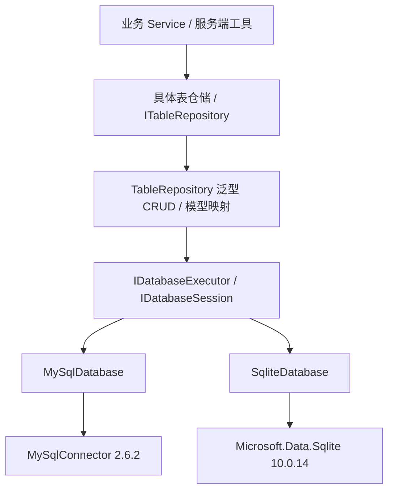

# 数据库访问层与表仓储开发指南

已有数据表可以直接使用 [表仓储代码生成工具](schema-generation.md)，自动生成 Row、Repository 及保留手写代码的 partial 扩展文件；MySQL、SQLite 均支持。下面说明底层接口和手写扩展方式。

已实现 MySQL、SQLite 两种后端，默认仍为 MySQL。业务代码使用相同的数据库接口和表仓储接口；驱动、连接、参数、资源释放和事务由底层统一处理。



`GameServer.Data` 是独立基础库，不依赖 Gameplay、Networking 或 Host。Infrastructure 中的具体表仓储适配现有业务接口。Protocol 不引用数据库包。

## 1. 底层已经封装什么

| API | 用途 |
| --- | --- |
| `ExecuteAsync` | 执行参数化增删改，返回影响行数 |
| `ScalarAsync` | 查询一个标量，例如 COUNT |
| `QueryAsync` | 使用映射函数读取结果，限制最大行数，自动释放 reader |
| `InsertIdentityAsync` | 插入并在同一个连接读取自增主键 |
| `WithSessionAsync` | 多个命令使用同一连接，回调结束释放 |
| `InTransactionAsync` | 同一连接、同一事务，成功提交、异常/取消回滚 |

连接打开、池租用、命令创建、参数绑定、reader/command/connection 释放和底层异常分类均在基础库中。业务代码不需要重复这些流程。MySQL 使用原生异步调用与共享 MySqlDataSource；SQLite 使用有并发上限的线程池执行同步原生 I/O，并在取消时请求 SQLite 中断，不把驱动的同步实现当成真正异步。

```csharp
await using IDatabase database = DatabaseFactory.Create(new()
{
    Provider = DatabaseProvider.Sqlite,
    ConnectionString = "Data Source=:memory:"
});

object? count = await database.ScalarAsync(
    new SqlStatement("SELECT COUNT(*) FROM account WHERE device_id=@device",
        ("device", deviceId)), cancellationToken);
```

上面的查询示意假定表已初始化，初始化方式见第 6 节；完整示例程序会建立自己的 example_* 表并自行验证。

参数名称不带 `@`，SQL 中的占位符带 `@`。值通过驱动参数绑定，不能用字符串插值拼用户输入。只有已验证的表/列标识符由框架构造；复杂 SQL 的文本由开发人员编写。

## 2. 新增普通表：模型即可获得 CRUD

使用标准 DataAnnotations，不增加一套自定义映射属性：

```csharp
using System.ComponentModel.DataAnnotations;
using System.ComponentModel.DataAnnotations.Schema;

[Table("player_settings")]
public sealed class PlayerSettingsRow
{
    [Key] public long PlayerId { get; set; }
    public string Language { get; set; } = "en";
    public bool SoundEnabled { get; set; } = true;
}
```

然后直接使用通用表接口：

```csharp
ITableRepository<PlayerSettingsRow, long> table =
    new TableRepository<PlayerSettingsRow, long>(database);

await table.InsertAsync(new() { PlayerId = 7, Language = "zh" }, ct);
var row = await table.GetAsync(7, ct);
row!.SoundEnabled = false;
await table.UpdateAsync(row, ct);
var page = await table.ListAsync(limit: 50, offset: 0, ct: ct);
var chinese = await table.FindByAsync(nameof(PlayerSettingsRow.Language), "zh", ct: ct);
long total = await table.CountAsync(ct);
await table.DeleteAsync(7, ct);
```

普通表可以只有模型，不强制再写一个没有逻辑的 Repository。需要具体类型时，继承一行即可：

```csharp
public sealed class PlayerSettingsRepository(IDatabaseExecutor database)
    : TableRepository<PlayerSettingsRow, long>(database);
```

默认把 PascalCase 属性转换为 snake_case 列名，例如 `PlayerId -> player_id`。`[Column("实际列名")]` 可覆盖，`[NotMapped]` 排除属性。模型使用无参构造和公开可写属性，元数据和访问器按 CLR 类型缓存，读取行时不逐行反射查找属性。

主键为一个 `[Key]` 属性，或约定名 `Id`；当前不支持复合主键。自增主键标记 `[DatabaseGenerated(DatabaseGeneratedOption.Identity)]`，类型为 int 或 long。默认值 0 表示由数据库生成，插入后会更新模型的 Id；显式提供非默认主键时可以插入指定值，便于兼容原有账号 ID 和导入数据。

查询默认按主键排序，每页默认 100 行、最多 1000 行；`FindByAsync` 的字段参数使用 `nameof`，不能传用户构造的 SQL 片段。查询 NULL 会生成 IS NULL。

## 3. 需要专用操作：只添加那几个方法

实际可编译的背包示例：[模型](../examples/GameServer.DatabaseExample/InventoryItemRow.cs)、[仓储](../examples/GameServer.DatabaseExample/InventoryRepository.cs)。

```csharp
public sealed class InventoryRepository(IDatabaseExecutor database)
    : TableRepository<InventoryItemRow, long>(database)
{
    public ValueTask<IReadOnlyList<InventoryItemRow>> ForPlayerAsync(long playerId, CancellationToken ct) =>
        FindByAsync(nameof(InventoryItemRow.PlayerId), playerId, ct: ct);

    public async ValueTask<bool> TryConsumeAsync(long id, int quantity, CancellationToken ct)
    {
        ArgumentOutOfRangeException.ThrowIfNegativeOrZero(quantity);
        return await Database.ExecuteAsync(new SqlStatement(
            $"UPDATE {TableName} SET quantity=quantity-@quantity WHERE id=@id AND quantity>=@quantity",
            ("quantity", quantity), ("id", id)), ct) == 1;
    }
}
```

这里的 TableName 来自经过验证和引用的模型元数据，玩家输入仍通过参数传递。`QueryRowsAsync` 与 `SelectColumns` 可复用通用模型映射，示例中的 `FindItemAsync` 展示了双条件查询；JOIN 或统计投影也可使用底层 `QueryAsync` 显式映射结果。

通用 `UpdateAsync` 按主键覆盖普通列，不自动提供版本比较。余额、数量、进度等存在并发业务约束的数据应使用原子条件 SQL 或版本号方法，不能“先读取数量，再无条件覆盖”。背包示例提供原子扣减，当前玩家进度仓储保留版本 CAS。

## 4. 已提供的五个参考目标

| 模板 / 实现 | 适用场景 | 额外方法 |
| --- | --- | --- |
| [AccountRepository](../src/GameServer.Infrastructure/Persistence/Tables/AccountRepository.cs) / AccountRow | 账号表，兼容原有 id/device_id | 按设备查找，适配登录接口 |
| [PlayerProgressRepository](../src/GameServer.Infrastructure/Persistence/Tables/PlayerProgressRepository.cs) / PlayerProgressRow | 玩家进度与版本号 | 原子条件更新、首次创建竞争 |
| [FacebookBindingRepository](../src/GameServer.Infrastructure/Persistence/Tables/FacebookBindingRepository.cs) / FacebookBindingRow | 平台账号唯一绑定 | 幂等绑定、唯一约束冲突处理 |
| [InventoryRepository](../examples/GameServer.DatabaseExample/InventoryRepository.cs) / InventoryItemRow | 道具、背包类表 | 按玩家查询、双条件查询、原子扣减 |
| [PlayerSettingsRepository](../examples/GameServer.DatabaseExample/PlayerSettingsRepository.cs) / PlayerSettingsRow | 设置、偏好等简单表 | 无需专用逻辑，直接继承 CRUD |

前三个已经接入实际服务器，后两个是独立可运行的扩展示例。上述具体仓储继承通用 CRUD；现有 Service 仍依赖 IAccountRepository 等业务接口，不直接接触驱动。

服务端 DI 普通注册：

```csharp
services.AddSingleton<InventoryRepository>();
services.AddSingleton<ITableRepository<InventoryItemRow, long>>(sp =>
    sp.GetRequiredService<InventoryRepository>());
```

已有 Host 注册了 IDatabase / IDatabaseExecutor，表仓储只保存执行器和元数据，不保存一个长期共享的打开连接。不要为每个玩家创建数据库池，也不要把 MySqlConnection/SqliteConnection 注册成全局共享连接。

## 5. 跨表事务：明确使用同一个 session

```csharp
await database.InTransactionAsync(async (session, ct) =>
{
    var inventory = new InventoryRepository(session);
    var settings = new PlayerSettingsRepository(session);

    await inventory.InsertAsync(new() { PlayerId = playerId, ItemCode = "reward", Quantity = 1 }, ct);
    await settings.UpdateAsync(new() { PlayerId = playerId, Language = "zh" }, ct);
    return true;
}, ct: cancellationToken);
```

事务回调中的仓储必须用 **session** 创建；继续使用默认注入的 root 仓储会另取连接，不属于这个事务。没有 AsyncLocal 隐式事务，也不要求仓储自身打开或提交事务。

- 会话中的命令串行执行，避免同一连接被并发使用；等待数同样有限。
- 回调成功才提交，未处理异常和取消会回滚。
- 事务内一旦有数据库命令失败，该事务即进入失败状态；即使调用者 catch 了数据库异常，也不能继续提交部分结果，会得到 TransactionAborted。需要重试时重新建立完整事务，不在已失败的事务中继续。
- 条件更新返回 false 本身不是数据库异常。业务要求失败即全部回滚时，调用者应抛出业务异常。
- session 只能在回调范围内使用，回调返回后会关闭；所有操作都应 await，不能让后台任务持有 session。
- 默认隔离级别 Serializable；其他隔离级别是否可用取决于后端，SQLite 不提供完整的 MySQL 隔离级别集合。
- 取消或连接在提交时断开可能导致结果无法确认，框架不会盲目重放写入；重要业务仍需要幂等键或版本条件。事务回滚也不会撤销 C# 模型里已填入的自增 Id。

## 6. 选择后端、初始化与运行示例

正式 TCP Host 默认配置：

```json
{
  "Database": {
    "Provider": "MySql",
    "ConnectionString": "",
    "MaximumPoolSize": 64,
    "MaxConcurrentOperations": 0,
    "MaxQueuedOperations": 128,
    "ConnectionTimeoutSeconds": 3,
    "CommandTimeoutSeconds": 3,
    "ValidateSchemaAtStartup": true
  }
}
```

环境变量示例：

```bash
export GAMESERVER_Database__Provider=MySql
export GAMESERVER_Database__ConnectionString='<MySQL 连接字符串>'
# 或选择 SQLite 的持久化文件：
export GAMESERVER_Database__Provider=Sqlite
export GAMESERVER_Database__ConnectionString='Data Source=/absolute/path/game.db'
```

游戏链路仍默认 AES-GCM，数据库后端选择不改变加密开关。MySQL 自身的网络加密由其连接字符串控制，与游戏连接 TLS 无关。玩家存档当前仍通过 FilePlayerSaveStore 保存文件，并不会因为选择 SQLite 自动迁移到数据库。

表结构脚本：新开发 MySQL 库使用 [mysql-new-database.sql](../sql/mysql-new-database.sql)，SQLite 使用 [sqlite-schema.sql](../sql/sqlite-schema.sql)。原 [tcp-schema.sql](../sql/tcp-schema.sql) 继续用于已有 MySQL 账号库增加本服务的两张表。新账号表假定自增主键；已有非自增账号表可用显式 Id 插入，不能假设框架会自动改成自增。

无需安装 SQLite CLI，先构建，再运行示例：

```bash
dotnet build TcpGameServer.sln -c Release
# 默认在 SQLite 内存库演示完整 CRUD、提交和回滚，不留下数据库文件：
dotnet run --project examples/GameServer.DatabaseExample -c Release --no-build

# 显式初始化一个 SQLite 开发文件：
export GAMESERVER_DATABASE_EXAMPLE_CONNECTION_STRING='Data Source=/absolute/path/dev-game.db'
dotnet run --project examples/GameServer.DatabaseExample -c Release --no-build -- --initialize-schema

# MySQL 示例/初始化必须明确指定开发连接，不能指向生产库：
export GAMESERVER_DATABASE_EXAMPLE_CONNECTION_STRING='<MySQL 开发库连接字符串>'
dotnet run --project examples/GameServer.DatabaseExample -c Release --no-build -- --mysql
dotnet run --project examples/GameServer.DatabaseExample -c Release --no-build -- --mysql --initialize-schema
```

初始化命令只执行显式的 CREATE TABLE IF NOT EXISTS，不为已有表执行 ALTER 或数据迁移。模型属性不是数据库迁移文件：主键、唯一索引、外键、非空、精度和长度约束仍需要在建表/迁移 SQL 中维护。`[Required]`、`[MaxLength]` 等验证属性不会自动替代 Service 验证或 SQL 约束。

## 7. 资源上限与错误

MaxConcurrentOperations=0 时，MySQL 默认按池大小 64 限制，SQLite 默认 4 个操作；等待操作默认最多 128 个，超出立即 Busy。一个 session 中最多一个命令运行，命令等待数同样受 MaxQueuedOperations 限制。MySQL 强制启用池并限制大小；SQLite 连接由已准入操作短期持有，不使用无上限的连接池。

SQLite 只有一个写入者，驱动的同步 I/O 和锁等待不会因为接口有 Async 后缀就消失。框架有界调度并请求原生中断，但锁等待和部分原生操作仍受命令超时约束，不承诺毫秒级立即取消。MySQL 的连接池并发、SQLite 本地文件并发与实际吞吐不能等同。

调用方统一捕获 `DatabaseException`，读取 Error：UniqueConstraint、Constraint、ConcurrentWrite、Busy、Timeout、Unavailable、TransactionAborted 或 Other；底层异常保留在 InnerException 中供受控诊断，不应把连接信息、SQL 参数或底层错误正文直接返回客户端。

这是轻量表访问层，不是完整 ORM。当前支持单主键、平面可写模型和显式 SQL 扩展，不提供 LINQ 翻译、关系导航、自动迁移或变更跟踪。不同数据库的类型、排序、大小写和锁语义仍由实际 schema/驱动决定。大 BLOB 应另外设计大小限制或流式存储，分页行数上限不等于总字节上限。

这些 CRUD 是服务端开发接口，不是允许客户端任意操作数据表的网络协议；玩家归属、权限与业务规则继续由 Service 校验。

## 验证

双数据库使用同一套测试验证 CRUD、主键回填、字段映射、NULL、参数化查询、分页、唯一约束、并发原子扣减、跨表提交/回滚、失败事务保护、取消后连接恢复、队列上限及释放。SQLite 还通过了实际 TCP 明文和 AES-GCM 登录/进度流程。完整测试、依赖审计和示例日志见本轮审查报告。
