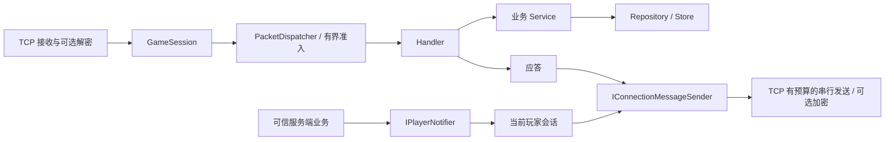

# 模块、命名与主动推送

当前服务器继续采用独立 TCP＋AES-GCM，保留 `Encryption.Mode=None` 明文开关。本轮借鉴 GameServer2026 的统一推送出口、模块注册和管理服务边界，独立实现适合当前 TCP 工程的组件，不依赖 SignalR、WebSocket 或 HTTP 游戏入口。

## 命名约定

| 后缀 | 职责 | 当前示例 |
| --- | --- | --- |
| Service | 由请求触发的业务用例与规则 | AccountService、PlayerSaveService、PlayerProgressService、FacebookBindingService |
| Manager | 运行时集合、绑定关系与生命周期 | SessionManager、PlayerManager |
| Handler | 消息解析入口、调用业务服务、构建应答 | LoginHandler、SaveReadHandler |
| Module | 集中注册本模块服务与消息处理器 | AccountModule、PlayerSaveModule |
| Repository / Store | 数据访问与存储接口/实现 | IAccountRepository、IPlayerSaveStore |
| Sender / Notifier | 消息发送、目标路由与通知出口 | IConnectionMessageSender、IPlayerNotifier |

原 `AccountSystem`、`PlayerSaveSystem`、`PlayerProgressSystem`、`FacebookSystem` 分别改为上述四个 Service。这些类不是按帧执行的 ECS 系统，Service 更贴合实际职责。若将来有 MovementSystem、CombatTickSystem 等按帧运行的玩法模块，可以继续使用 System；不需要机械地把所有类都命名为 Service。

每个业务模块的接口、记录类型、服务与处理器分文件存放，命名空间仍为 `GameServer.Gameplay.Modules.<模块>`。Module 通过显式 `Add...Module` 注册，避免全程序集反射扫描；所有单例由 DI 管理，不新增静态全局 Instance。

## 当前消息链路



`GameSession` 只提交消息，不再持有 BufferPools 或计算加密后的长度；`ConnectionMessageSender` 集中完成帧编码、大小验证和租借归还。原有“完整发送完成前保持缓冲区有效”的约定不变。

## 统一通知出口

业务代码依赖 `IPlayerNotifier`，不自行遍历 socket 或重复实现编码。示例为可信服务端内部调用：

```csharp
var notifier = host.Services.GetRequiredService<IPlayerNotifier>();
bool sent = await notifier.NotifyAsync(playerId, MessageId.ServerNotice,
    new ServerNotice { Text = "服务器公告" }, cancellationToken);

NotificationBroadcastResult result = await notifier.NotifyManyAsync(playerIds,
    MessageId.ServerNotice, new ServerNotice { Text = "活动开始" }, cancellationToken);
```

- 单发只定位该玩家当前已认证且打开的会话；没有另外建立一份玩家/连接缓存。旧连接被替换后不会继续作为后续查找的推送目标；已经开始的发送仍遵循连接关闭和取消规则。
- 广播接收人去重，分别统计 TargetCount / SentCount / UnavailableCount。离线、关闭或网络发送失败的目标计入不可用，不阻止其他有效目标发送。参数错误与调用者取消继续抛出。
- `sent=true` 表示完整帧已写出，不是客户端确认收取。需要可靠到达/重试的业务应另行定义消息确认机制。
- 收件人必须由调用方依据服务端业务权限选定。当前不提供客户端任意选择公会/房间后广播的接口，也没有虚构房间成员或权限规则。
- 调用方须等待发送结束，且在此期间不修改共享 Protobuf 消息。广播没有无限等待队列或“为全部收件人一次建立一个 Task”的实现。

广播上限通过以下配置修改，默认值即示例值：

```json
{
  "Gameplay": {
    "Notifications": {
      "MaxBroadcastRecipients": 8000,
      "BroadcastConcurrency": 16,
      "MaxConcurrentBroadcasts": 2
    }
  }
}
```

超出同时广播数量立即返回 ServerBusy；单次广播超过人数限制会拒绝。发送继续使用原有每连接发送数/字节数预算、全局发送预算、池预算和发送超时。没有为每个连接增加一个通知队列或保留缓冲区。

## 通知协议与客户端

原有 GWS1 v2 包头、请求应答和 AES-GCM 帧格式不变。新增服务端通知消息号区间 `2100000000..2147483647`，目前提供 `ServerNotice=2100000001`。通知使用 `RequestId=0`、`ResultCode=Ok`；客户端仍可按原规则发送业务请求，应答原样保留请求号。客户端发来的通知消息号没有业务处理入口，会被拒绝并关闭连接。

示例客户端 `ClientPacketTransport` 新增 `NotificationReceived` 事件和 `ReadNotificationAsync`。`ExchangeAsync` 在等应答时会先处理插入的通知，再继续等待匹配的应答；`ReadNotificationAsync` 用于没有请求在途时等待通知。两种读取不能并发执行，正式游戏客户端应使用统一接收循环分流应答与通知。

事件 payload 指向可复用接收缓冲区，只在本次回调中有效；需要保存时主动复制。该工具仍是使用 4 KiB 帧缓冲的示例/压测适配器，不替代正式客户端完整的最大帧接收实现。服务端推送不会替客户端刷新入站活动期限，客户端继续按现有规则发送心跳。

## 管理踢人

```csharp
var administration = host.Services.GetRequiredService<IPlayerAdministrationService>();
bool disconnected = administration.Kick(playerId);
```

管理服务直接关闭选中的会话，不等待客户端响应，也不以客户端主动断开为唯一回收方式。它不在选择后重新按 playerId 查一次连接，因此不会把并发建立的替代连接误作为旧连接关闭。断线后仍由统一生命周期回收会话、玩家绑定、连接槽位和缓冲区。

Kick 是踢下线，不是封禁：后续持有效凭证重新登录仍然允许。该接口仅供可信 Host/管理代码调用，本轮没有新增公网 HTTP 管理端口或客户端踢人消息；接入运营工具时，权限检查由可信管理入口负责。

## 验证与备份

后续数据库封装已加入独立 Data 基础库，当前版本共有 104 项测试通过；本节下方保留模块改进阶段的 77 项测试与当时回归。最新开发入口见 [数据库指南](database.md) 和 [本轮审查](code-review-20261104.md)。

本轮 [77 项测试通过](benchmarks/modules-20261104/tests.log)（46 单元、31 集成）。新增验证包括：推送只定位当前会话、广播去重与失败隔离、并行发送和同时广播限制、取消后容量恢复、并发替换期间踢人不会误关新连接、缓冲区发送完成前的所有权，以及明文/AES 两种模式下的通知与应答交错和实际踢人回收。

对当前模块版另跑了一次 8000 连接 AES-GCM 回归：客户端与服务端正常退出，无失败、无预算看门狗违规；预热后空闲 RSS 177.8 MiB，持续通信采样峰值 194.5 MiB，1 KiB 回显约 28060 次/秒。最后服务端日志确认连接、会话、玩家、收发缓冲区和待发送计数归零。[配置与 DLL 指纹](benchmarks/modules-20261104/regression-aes/configuration.json)、[阶段汇总](benchmarks/modules-20261104/regression-aes/summary.json)、[资源采样](benchmarks/modules-20261104/regression-aes/resources.csv)、[服务端日志](benchmarks/modules-20261104/regression-aes/server.log)。

这次是单轮回归，使用项目现有脚本按时间预热（心跳与回显各 3 秒），不是此前固定预热请求数、固定速率阶段的三模式比较。RSS 为服务器进程内存，不含客户端、MySQL 与内核 socket；4 核服务器/1 核客户端、本机回环、采样式预算看门狗的限制仍适用。该通信回归不测量真实广播业务的极限吞吐；广播限额和失败处理由新增功能测试覆盖。

修改前备份位于 `/workspace/experiments/tcp-modules-20261104-141058/before.tar.gz`。此前三模式性能对照继续作为当时版本的历史基线；本轮回归数据另行记录，不用新版本的单次结果重新计算旧版 TLS 对比百分比。
