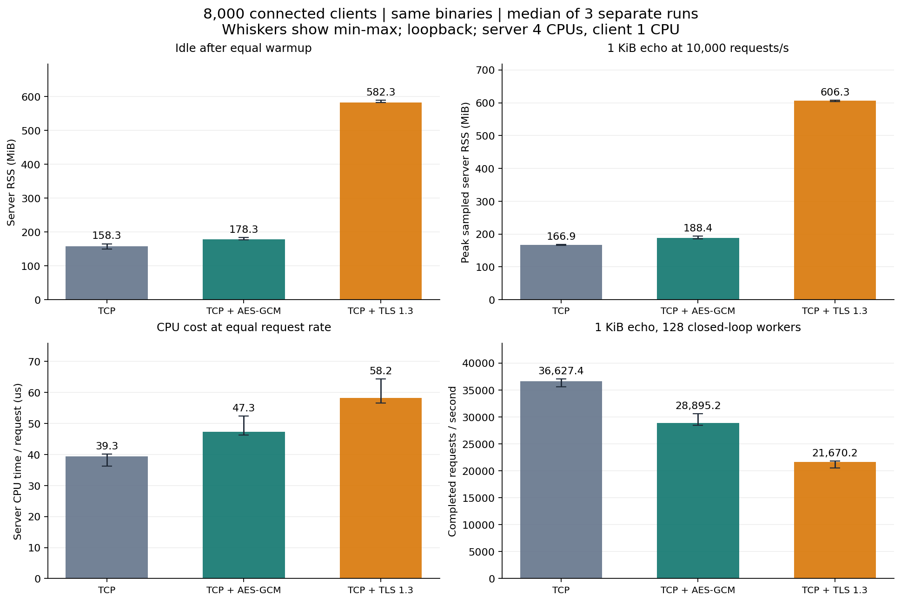

# TCP＋AES-GCM 与 TCP＋TLS：同条件实测

本页记录模块重构前的三轮对照。后续已采用 AES-GCM 为默认，并增加模块注册、统一消息发送、推送与管理服务；当前实现及其独立回归见 [模块设计](modules.md)。以下结果对应保留的源码快照和 DLL 指纹，原始证据未改写，不视为当前模块版的重新测量。

本次在相同代码、相同 8000 在线连接和相同负载下，**AES-GCM 的空闲 RSS 比 TLS 低 69.4%，固定请求速率下 RSS 峰值低 68.9%**。两者都正常完成全部测试。下面所有数字均来自本次九次运行，使用每个模式三轮的中位数，没有混用旧 WS/TLS 实验数据。

测试时间：北京时间 2026-11-04 13:33:54 至 13:50:03。正式 TCP 工程没有加回 TLS：对照能力只存在于 `/workspace/experiments/tcp-tls-comparison-20261104-132823/reference` 测试副本。生产源码变动检查见下方说明。

## 条件与统计口径

- 同一套 Release DLL，三个模式各运行三次；每轮交替顺序：plain→AES→TLS、AES→TLS→plain、TLS→plain→AES。每次重启服务端和客户端；九次配置中的全部 DLL SHA-256 完全一致。
- .NET 10.0.14 / SDK 10.0.403，Linux x64，OpenSSL 3.5.7，系统默认分配器，没有 jemalloc、强制 GC 或非托管接收缓冲区。
- 沙盒可用 5 个逻辑 CPU，服务器绑定 4 个，客户端绑定另 1 个；主机型号 AMD EPYC 9V74，宿主可见内存约 33.3 GiB。不能直接视为线上 4 核 2.5 GHz / 4 GB 机器。
- 每组 8000 个不同账号，约 700 登录/秒，真实 JWT 与 MySQL 校验。8000 是同时在线数，**不是同一瞬间发起 8000 次握手**，也不是测出的极限连接数。
- 128 个工作任务；先固定 32000 次心跳与 32000 次 1 KiB Protobuf 回显预热，再空闲 15 秒。随后固定 10000 次/秒回显 20 秒，共 200000 次；满速心跳 20 秒、满速回显 20 秒、空闲 10 秒，最后断开观察 7 秒。
- 1024 字节数据经 Protobuf 封装后为 1027 字节负载，包头另计。测试回显仅在测试入口注册，不会向正式 Host 增加接口。
- TLS 对照使用 SslStream、TLS 1.3、共享证书上下文、RSA-2048 本地证书，客户端验证 localhost 主机名并显式信任测试证书；实际协商 **TLS_AES_256_GCM_SHA384**。没有禁用证书验证，也没有让每个连接重复加载一份证书。
- 三个模式的业务、准入限制、零字节读取和托管池相同。TLS 收发经过 SslStream；AES 与纯 TCP 保持原有直接 socket 完整发送路径。测试覆盖差异见 [overlay patch](benchmarks/tls-comparison-20261104/comparison-overlay.patch)。

## 内存

单位为 MiB（1,048,576 字节），数字格式为 **中位数（最小值–最大值）**。RSS 是服务器单个进程驻留内存，不含客户端、MySQL、内核 socket 缓冲。RSS 峰值为约 250 ms 采样的阶段最大值，可能漏掉很短的尖峰。

| 相同阶段 / 指标 | 纯 TCP | TCP＋AES-GCM | TCP＋TLS 1.3 |
| --- | ---: | ---: | ---: |
| 相同预热后空闲 15 秒，阶段末 RSS | 158.3（149.8–165.3） | 178.3（176.7–183.2） | 582.3（582.3–589.6） |
| 固定 1 万次/秒回显，RSS 峰值 | 166.9（165.9–168.7） | 188.4（185.1–194.1） | 606.3（603.3–608.0） |
| 满速心跳，RSS 峰值 | 165.9（164.0–168.0） | 190.1（189.0–190.5） | 593.5（590.5–601.6） |
| 满速 1 KiB 回显，RSS 峰值 | 167.8（164.5–172.2） | 190.2（189.0–191.0） | 590.6（590.1–597.9） |
| 通信后空闲 10 秒，阶段末 RSS | 159.6（154.7–161.2） | 180.2（174.8–180.7） | 590.1（588.5–591.9） |

**本次可以确认，8000 连接下轻量 AES-GCM 版本的进程内存明显小于 TLS。** 空闲阶段 TLS 约为 AES 的 3.27 倍。固定速率阶段，两者实际处理相同的 200000 个请求，内存结论不依赖“哪个版本完成了更多请求”。

RSS 差包含协议对象、原生库状态、内存分配器保留和 GC 时点差异，不能全部归为某一个 TLS 缓冲区。运行时遥测每 5 秒一次，其托管估计和 GC committed 与 RSS 不同：

| 空闲阶段最近遥测 | 纯 TCP | TCP＋AES-GCM | TCP＋TLS 1.3 |
| --- | ---: | ---: | ---: |
| 托管内存估计 MiB | 36.5（32.1–45.2） | 50.2（38.6–53.2） | 62.4（56.2–65.5） |
| GC committed MiB | 72.9（61.8–73.1） | 73.4（72.4–77.4） | 84.1（84.1–89.2） |

托管估计不是完整存活对象统计，GC committed 也不等于全部进程内存，不能简单相减来判定泄漏。

## 相同通信量下的 CPU 与延迟

以下固定每秒 1 万次、每轮 200000 次 1 KiB 回显；服务器 CPU 百分比按 **4 核总容量**计算，100% 表示四核全部占满。CPU/请求为整个服务器进程累计 CPU 时间除以成功请求数。

| 指标 | 纯 TCP | TCP＋AES-GCM | TCP＋TLS 1.3 |
| --- | ---: | ---: | ---: |
| 实际完成请求/秒 | 9,996（9,950–9,996） | 9,997（9,997–9,998） | 9,996（9,985–9,997） |
| 服务器 CPU，占四核总量 % | 9.8（9.0–10.0） | 11.8（11.6–13.1） | 14.5（14.1–16.1） |
| 服务器 CPU/请求，µs | 39.3（36.2–40.1） | 47.3（46.4–52.4） | 58.2（56.5–64.4） |
| p99 往返延迟，ms | 20.75（18.60–22.50） | 22.00（21.40–25.30） | 29.95（29.90–31.90） |

在本次相同业务量下，AES-GCM 的服务器 CPU/请求比 TLS 低 18.6%。p99 是每轮 p99 的中位数，并非把三轮请求合并后计算的百分位。固定速率的延迟测量从实际开始发送到收到响应，不包含客户端等待预定发送时间的延迟；实际达成速率另列在表中。

## 满速吞吐与连接建立

满速部分是 128 个工作任务的闭环测试，实际完成请求数因模式而不同；服务器和单核客户端都可能影响吞吐，不能把结果当作服务器的绝对极限。

| 指标 | 纯 TCP | TCP＋AES-GCM | TCP＋TLS 1.3 |
| --- | ---: | ---: | ---: |
| 心跳请求/秒 | 35,148（31,368–37,830） | 29,738（28,632–31,880） | 22,159（21,109–24,809） |
| 1 KiB 回显请求/秒 | 36,627（35,568–37,037） | 28,895（28,440–30,572） | 21,670（20,527–21,822） |
| 1 KiB 回显 p99 往返 ms | 26.00（24.80–26.20） | 26.65（25.65–28.55） | 37.15（37.00–38.15） |
| 建立并登录 8000 连接耗时，秒 | 11.78（11.74–11.93） | 11.74（11.73–11.76） | 11.85（11.75–11.97） |
| 建连＋登录服务器 CPU/连接，ms | 0.610（0.585–0.618） | 0.699（0.658–0.734） | 1.625（1.614–1.845） |
| 建连＋登录 p99，ms | 31.90（26.10–40.35） | 52.30（45.35–75.45） | 91.05（86.70–94.00） |

AES-GCM 的 1 KiB 回显吞吐比 TLS 高 33.3%。登录阶段由客户端约 700/s 的节奏控制，因此总登录耗时接近不代表握手成本相同；CPU/连接和单连接延迟更能显示差别。

## 正确性、回收与边界

- 最终构建 0 警告、0 错误；**68 项测试全部通过**（原有 66 项，加 2 项 TLS 合包/分片/EOF 回收测试）。
- 九次压测，每次 8000 连接全部登录成功，客户端失败数均为 0，服务端/客户端退出码均为 0，无看门狗违规。固定负载每次均完成 200000 个请求。
- 每次空闲阶段服务端确认 Connections / Sessions / Players 均为 8000。断开后，Connections、Sessions、Players、Unauthenticated、Queued、Running、ReceiveInUse、SendInUse、PendingSend 全部归零。RSS 不保证马上恢复到启动值；本次短回收观察不能代替长期反复重连测试。
- 服务就绪探针额外建立并关闭一个连接，所以累计 Accepted=8001 不代表同时在线超过 8000。
- 使用 3 GiB GC 堆上限和采样式 4 GiB RSS 看门狗；沙盒没有真正的整进程 4 GiB cgroup 限制。这些是本地回环结果，不包含完整游戏逻辑、广播、持续写库和公网链路。
- AES-GCM 方案仍使用预共享通信密钥，客户端密钥可能被逆向提取；性能更好不代表获得 TLS 的全部身份认证和密钥保护能力。

之前约 170 MiB 的结果属于首次单轮实验，预热按持续时间控制；本次改为固定预热请求数，并新增固定速率阶段。**判断 AES 与 TLS 的差异只使用本页同一批三轮数据**，旧单轮报告保留用于追溯，不拼接比较。

## 证据与复现

- [汇总 JSON（含所有单轮数值）](benchmarks/tls-comparison-20261104/comparison.json)、[运行时间与顺序](benchmarks/tls-comparison-20261104/runs.json)、[机器信息](benchmarks/tls-comparison-20261104/machine.json)、[SVG 图](benchmarks/tls-comparison-20261104/comparison.svg)。
- [构建日志](benchmarks/tls-comparison-20261104/build.log)、[测试日志](benchmarks/tls-comparison-20261104/tests.log)、[依赖锁定恢复](benchmarks/tls-comparison-20261104/restore.log)。
- 原始数据按 `round-N-plain`、`round-N-aes-gcm`、`round-N-tls` 存放在同一证据目录，每组包含配置、DLL 指纹、资源 CSV、服务器日志与客户端事件。
- [完整对照源码、脚本及数据包](/workspace/TcpGameServer-transport-comparison.tar.gz)，或阅读本地 [复现说明](/workspace/experiments/tcp-tls-comparison-20261104-132823/README.md)。

在该轮性能测试期间，正式 TCP 代码、测试和脚本与测试开始前的 SHA-256 保持一致。随后采用 AES-GCM 为默认配置，并补充开关与默认客户端验证；当时的源码快照、DLL 指纹和原始结果继续保留，未改写。未发布或推送任何内容。
